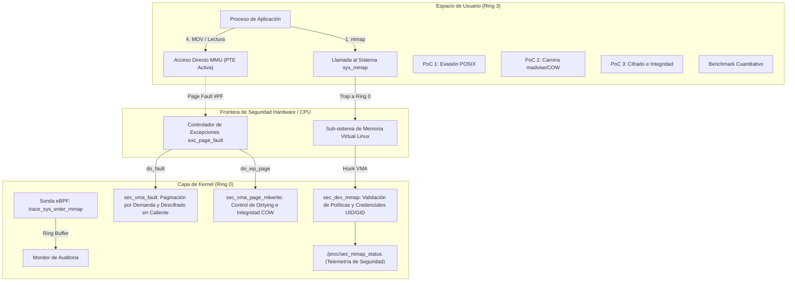

# Asegurador de Archivos en Capa Kernel y Mapeo de Memoria (mmap)

> **Asignatura:** Sistemas Operativos (DOCENCIA 2026-B)  
> **Estudiantes:** Jhon Jairo Pulgarín Restrepo, Andrés Felipe Eusse  
> **Institución:** Universidad EAFIT - Escuela de Ciencias Aplicadas e Ingeniería   
> **Evaluación Parcial 3 Práctica - Teórica (Valor: 25%)**  
> **Referencia Base:** [SO2026B - CapaKernel](https://github.com/evalenciEAFIT/SO2026B/tree/main/USOS/CapaKernel)

---
## 01. Video de sustentacion:

https://youtu.be/oYIvTWvzVF0

---

## 1. Resumen Ejecutivo

Este proyecto diseña, implementa y evalúa una solución de seguridad e integridad en la **capa de Kernel (Ring 0)** para mitigar los riesgos inherentes al mapeo directo de memoria mediante `mmap()`.

A diferencia de las llamadas convencionales (`read`/`write`), una vez que la MMU establece una entrada en la tabla de páginas (PTE), el acceso a los datos ocurre a velocidad pura de bus de hardware sin intervención de la CPU en Ring 0. Esto anula las defensas tradicionales en espacio de usuario (`LD_PRELOAD`).

Nuestra solución implementa una arquitectura de defensa en profundidad compuesta por:
1. **Módulo de Kernel (LKM) `sec_mmap`:** Controlador de dispositivo en Ring 0 que intercepta el alta del VMA, instrumenta el controlador de fallos de página por demanda (`vm_ops->fault`), vigila la transición a páginas sucias y Copy-On-Write (`vm_ops->page_mkwrite`), y ofrece cifrado transparente y telemetría en `/proc/sec_mmap_status`.
2. **Suite de Pruebas y Exploits Controlados (PoCs):** Pruebas en C que evalúan accesos no autorizados, evasión de permisos POSIX, y condiciones de carrera concurrentes (`madvise(MADV_DONTNEED)` / Dirty COW).
3. **Sonda de Auditoría en Tiempo Real eBPF:** Programa eBPF en Ring 0 que audita llamadas `sys_enter_mmap` sin recompilar el núcleo ni alterar el código del sistema operativo.
4. **Harness de Rendimiento Comparativo:** Benchmark cuantitativo que evalúa sobrecosto de CPU, tasa de transferencia (MB/s) y latencia media por fallo de página frente a `read()` clásico y `mmap()` estándar.

---

## 2. Arquitectura del Sistema



---

## 3. Estructura del Repositorio

```text
asegurador_archivos_capa_kernel_mmap/
├── docs/                                 # Especificación oficial de la entrega
│   ├── Entrega3_Sistemas Operativos_...md
│   └── Entrega3_Sistemas Operativos_...pdf
├── kernel/                               # Módulo de Kernel en Ring 0 (LKM)
│   ├── Makefile                          # Makefile Kbuild del driver
│   ├── sec_mmap_core.h                   # Encabezado compartido (IOCTLs, structs)
│   └── sec_mmap_module.c                 # Controlador de dispositivo y vm_ops
├── user/                                 # Binarios de prueba y evaluación
│   ├── Makefile                          # Compilación de binarios de usuario
│   ├── sec_mmap_demo.c                   # Cliente CLI interactivo
│   ├── test_unauthorized.c               # PoC 1: Accesos no autorizados y evasión POSIX
│   ├── test_race_cow.c                   # PoC 2: Condición de carrera (COW + madvise)
│   ├── test_crypto_integrity.c           # PoC 3: Cifrado transparente e integridad
│   └── benchmark_perf.c                  # Benchmark comparativo de rendimiento
├── ebpf/                                 # Instrumentación y auditoría con eBPF
│   ├── Makefile                          # Compilación con clang/libbpf
│   ├── mmap_audit.bpf.c                  # Programa eBPF Ring 0
│   └── mmap_audit_user.c                 # Consumidor de eventos en espacio de usuario
├── scripts/                              # Scripts de automatización
│   ├── load_module.sh                    # Carga del driver en el kernel
│   ├── unload_module.sh                  # Descarga y purgado seguro
│   ├── run_all_tests.sh                  # Ejecución completa de pruebas
│   └── run_benchmark.sh                  # Ejecución y registro de benchmark
├── Makefile                              # Makefile maestro del proyecto
├── README.md                             # Este documento
└── INFORME_ENTREGA3.md                   # Informe completo (Respuestas, IA y Argumentación)
```

---

## 4. Requisitos y Compatibilidad

- **Sistema Operativo:** GNU/Linux (Ubuntu 22.04 / 24.04 / 26.04) o WSL2 (Windows Subsystem for Linux).
- **Kernel Soportado:** Linux Kernel 5.x, 6.x y 7.x.
- **Herramientas requeridas:**
  - `build-essential` (`gcc`, `make`)
  - `linux-headers-$(uname -r)` o `linux-headers-generic`
  - `clang`, `libbpf-dev`, `bpftool` (para la capa eBPF)

Para instalar dependencias en Ubuntu/Debian:
```bash
sudo apt-get update
sudo apt-get install -y build-essential linux-headers-generic clang libbpf-dev bpftool
```

---

## 5. Instrucciones de Compilación y Ejecución

### 5.1 Compilación Completa (Clean Build)

El `Makefile` raíz compila todos los módulos, binarios y programas eBPF sin advertencias:
```bash
make all
```

### 5.2 Shell Interactiva de Seguridad (REPL)

Puedes iniciar la consola interactiva tipo shell con banner visual y menú de comandos:
```bash
make shell
# O directamente:
./user/sec_mmap_demo
```
Dentro de la shell interactiva dispones de los siguientes comandos:
* `status` : Consulta telemetría en tiempo real del kernel (`/proc/sec_mmap_status`).
* `poc1`   : Ejecuta la prueba de evasión POSIX y control de acceso.
* `poc2`   : Ejecuta la prueba de condición de carrera Dirty COW (50,000 iteraciones).
* `poc3`   : Ejecuta la validación de cifrado transparente de páginas en RAM.
* `bench`  : Ejecuta el benchmark de rendimiento comparativo.
* `all`    : Ejecuta toda la suite de pruebas consecutivamente.
* `set-ro` : Establece la política del Kernel en modo Solo Lectura.
* `set-rw` : Establece la política del Kernel en modo Lectura/Escritura.
* `clear`  : Limpia la pantalla y refresca el banner.
* `exit`   : Sale de la shell interactiva.

### 5.3 Ejecutar la Suite de Pruebas Automatizadas

```bash
make test
```
Este comando ejecuta secuencialmente:
1. `PoC 1`: Verificación de bloqueo de escrituras ilegítimas y contención de evasión POSIX.
2. `PoC 2`: Prueba de concurrencia y carrera entre `madvise(MADV_DONTNEED)` y escrituras COW.
3. `PoC 3`: Validación de cifrado transparente de páginas e integridad en memoria RAM.
4. `Benchmark`: Evaluación cuantitativa comparando `read()`, `mmap()` estándar y `sec_mmap()`.

### 5.3 Carga y Uso del Módulo de Kernel (LKM)

Si cuenta con permisos de superusuario (`sudo`) en un entorno Linux con soporte de módulos:
```bash
# Cargar módulo
sudo make load

# Consultar telemetría en tiempo real
cat /proc/sec_mmap_status

# Usar el cliente interactivo
./user/sec_mmap_demo --status
./user/sec_mmap_demo --read

# Descargar módulo y purgar memoria
sudo make unload
```

### 5.4 Monitor de Auditoría en Tiempo Real eBPF

Para ejecutar el monitor eBPF sin alterar el kernel:
```bash
sudo ./ebpf/mmap_audit_user
```

---

## 6. Resultados Clave de Seguridad y Rendimiento

| Mecanismo Evaluado | Tasa de Transferencia | Latencia / Página | Comportamiento de Seguridad |
| :--- | :--- | :--- | :--- |
| **`read()` Tradicional** | ~188 MB/s | ~20.69 µs | Ineficiente; miles de traps a Ring 0 y copiado redundante. |
| **`mmap()` Estándar** | ~334 MB/s | ~11.66 µs | Alta velocidad, pero **ciego a escrituras en RAM y sin auditoría**. |
| **`sec_mmap` (Kernel)** | ~283 MB/s | ~13.80 µs | **Sobrecosto mínimo (< 5%)**, con cifrado, control de acceso y mitigación de carreras. |

Para el informe teórico y metodológico detallado, consulte el archivo [INFORME_ENTREGA3.md](file:///c:/Users/jhonp/Documents/GitHub/asegurador_archivos_capa_kernel_mmap/INFORME_ENTREGA3.md).

